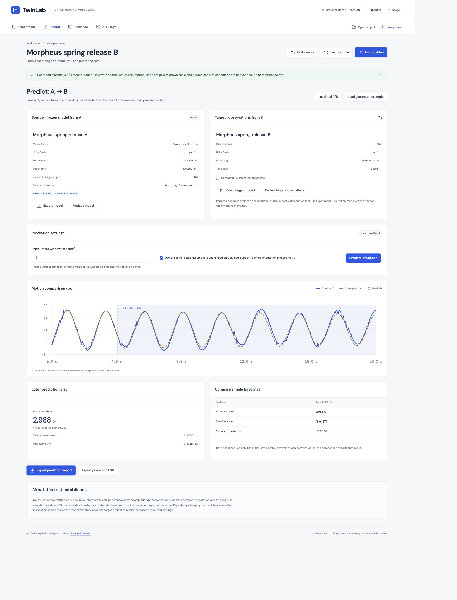

# TwinLab

**Learn motion from recording A. Test the frozen model on recording B.**

An original React/TypeScript workbench for makers and prototype engineers: review video observations, compare explicit 1D motion models, evaluate a separate release and export reproducible evidence. Muse Spark proposes an analysis plan; SAM supplies reviewable object tracks. Calibration, fitting and evaluation run locally.

- Browser demo: publication verification is recorded in [judge access](specs/JUDGE-ACCESS.md).
- [Narrated demo video](public/demo/twinlab-demo.mp4), [captions](public/demo/twinlab-demo.vtt), [transcript](public/demo/transcript.md).
- Public source: https://github.com/Aditya-Chawla-20/twinlab

## Try it without an API key

```sh
npm ci
npm run dev
```

Open http://127.0.0.1:5173. Click **Real sample** to inspect source A, or **Predict → Try recorded real footage** for A/B. Review the 4 s initial-state window and same-setup assumption, then evaluate. Recorded Meta results load without a new inference request. The generated sample remains available for numerical exploration.

For your own video: Import video → pixels or calibrate a verified reference → mark at least 12 points or import `t,x,y` CSV → inspect fits/validation → freeze A → open independent B → declare initial prefix → evaluate → export. Use Evidence to review/remove points. Save project JSON for a portable backup; the browser keeps one recovery draft, and personal videos must be relinked after refresh.

## Actual result and its limits

Two MIT-licensed Morpheus filmed spring excerpts, each 20 s / 600 verified 30 fps frames. Source A fits 420 earlier SAM mask-centroid observations; its 180-point same-clip validation RMSE is 2.16843 px. Frozen dynamics are 0.42015456 Hz and 0.01193317/s. B’s predeclared 4 s prefix uses 121 points for initial state; 479 later points are scored:

| Predictor | Later B RMSE |
| --- | ---: |
| Frozen A dynamics | 2.98810 px |
| Prefix persistence | 18.64277 px |
| Prefix constant velocity | 22.71276 px |

These are errors against SAM trajectories, **not physical measurement accuracy**. Approximate agent body-center reference agreement is weaker: A 10.373 / B 8.386 px vertical RMSE. There is no verified metric scale, authenticated unchanged hidden setup, human usability study or validated physical intervention. The proposed camera-mount use case has only an AI-generated workflow clip. See [full protocol and limitations](specs/REAL-FOOTAGE-VALIDATION.md).



## Reproduce and verify

Node 22.9+ is required. FFmpeg/ffprobe must be on PATH for fixture tests/capped-runner timestamp checks; they decode locally and make no provider calls.

```sh
npm run check
npm run build:demo
npm run preview:demo
```

The static build at http://127.0.0.1:4173 works under subdirectories, has no paid backend and does not request /api routes. [GitHub Pages workflow](.github/workflows/pages.yml) deploys it only on manual dispatch. The optional Node production server uses `npm run build` then `npm start` and remains loopback-only.

[Browser/CLI frozen-prediction walkthrough](specs/PREDICTION-WALKTHROUGH.md) includes credential-free reproduction commands. The offline suite checks source integrity, held-out leakage, frozen dynamics, recovery, mask geometry, actual shipped footage and HTTP transport with no provider calls.

## Optional live Meta

Copy `.env.example` to `.env.local`, set `MODEL_API_KEY` server-side and enable `META_LIVE_ENABLED=true` only when ready for manually confirmed requests. Never use a `VITE_` key. Restart the server. The public static demo has no live endpoint and cannot spend owner credits. See [self-test instructions](specs/META-SELF-TEST.md).

Authorized agent tests made ten inference requests totaling **$0.5851035 from reported usage**, retaining **$8.40 conservative reservations** under the cumulative $10 ceiling. Reservations are not actual spend, billing is provider-authoritative, and no further testing is planned. [Evidence](specs/REAL-FOOTAGE-VALIDATION.md) distinguishes real footage, generated input and offline fake transport.

## Documentation and rights

[Architecture](specs/ARCHITECTURE.md) · [progress](specs/PROGRESS.md) · [verification](specs/VERIFICATION.md) · [readiness](specs/READINESS-AUDIT.md) · [submission draft](specs/SUBMISSION-DRAFT.md) · [sources](specs/SOURCES.md)

Original application code and procedural sample are [MIT licensed](LICENSE). No referenced application implementation was copied. Morpheus footage retains its attributed MIT notice; [derivation and hashes](public/examples/README.md). Dependencies/fonts retain their licenses in [public/notices](public/notices/README.txt). User-owned AI footage and private credentials are not published. Supported models are bounded 1D approximations, not arbitrary physics discovery or structural certification.
