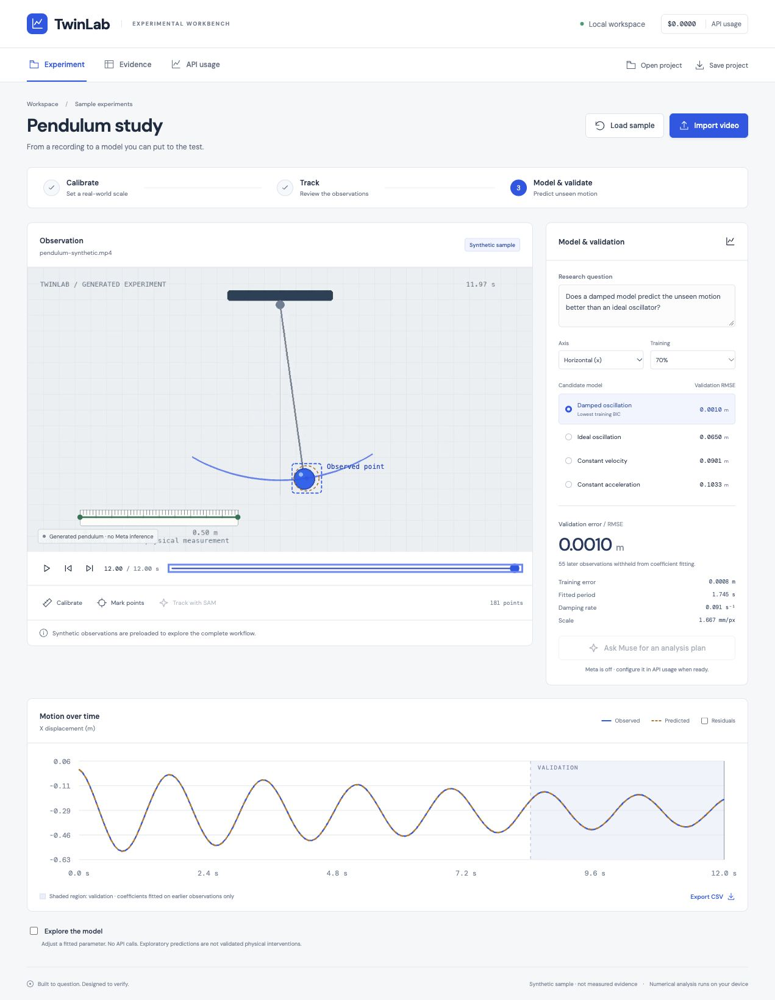

# TwinLab

Public source: https://github.com/Aditya-Chawla-20/twinlab

An original, local-first workbench for experimental video: calibrate, review observations, fit motion models and inspect predictions on later samples. Optional user-triggered Meta Muse Spark and SAM integration.

```sh
npm ci
npm run dev
```

Open http://127.0.0.1:5173. The generated pendulum sample works without credentials or paid requests.

```sh
npm run check
npm run build
npm start
```

For your own recording: import video → calibrate a reference length → mark a consistent landmark at 12+ times (or import `t,x,y` CSV) → inspect training/validation fits → export project, observations and report. Use Evidence to remove unreliable points. Reopen project JSON and relink its original video to reproduce it.

For user-run paid tests see [specs/META-SELF-TEST.md](specs/META-SELF-TEST.md). Credentials are server-only; live mode defaults off. Live Meta access was tested under a user-authorized cap on generated footage; real-video accuracy remains unverified. See [the test report](specs/AGENT-TESTING.md).

## Walkthrough

See [the guided demo](specs/WALKTHROUGH.md) for the sample workflow, model comparison, validation plot, exports and how the paid Meta stages will work.



## Documentation
- [Progress and decisions](specs/PROGRESS.md)
- [Architecture and scope](specs/ARCHITECTURE.md)
- [Sources and originality](specs/SOURCES.md)
- [Verification results](specs/VERIFICATION.md)
- [Hackathon demo and remaining gates](specs/HACKATHON.md)

The sample is procedurally generated, not footage of a real experiment or live Meta output. Fits are one-dimensional mathematical approximations; this app does not discover arbitrary physical laws or establish causation. Metric results require fixed-camera planar motion and correct calibration. SAM timestamps require confirmed constant frame rate. Numerical checks do not establish real-world measurement accuracy.

Application code is independently authored. Referenced projects are credited in SOURCES.md; no upstream application code is copied. Dependencies retain their own licenses.
