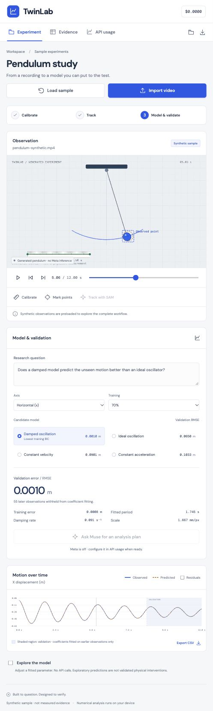

# TwinLab walkthrough

## Open the running app
Run `npm run dev` from the checkout, then open http://127.0.0.1:5173. This is a local app; the public GitHub repository hosts its source, not a live deployment.

The default Pendulum study is explicitly synthetic: generated video and 181 known observations, with no Meta inference. It lets you inspect the complete numerical workflow without a key or bill.

## 1. Watch and inspect the recording
Use Play/Pause, the video position slider, or previous/next approximate frame controls. The blue overlay is the observed path. The dashed amber marker is the model's predicted position along the selected axis.

For your own video, Import video starts a new local experiment. A fixed camera, motion in a plane and a visible reference length are required for metric interpretation.

## 2. Calibrate and review observations
Calibrate → enter the reference length in meters → click its two endpoints in the video. The keyboard alternative accepts native-pixel endpoint coordinates.

Mark points → pause at successive times → click the same physical landmark. Keyboard X/Y entry also works. A new point at an existing timestamp replaces that observation. Alternatively import numeric CSV with header `t,x,y` in Evidence.

The sample has a 0.50 m / 300 px reference and preloaded synthetic points. No additional marking is necessary to explore it.

## 3. Compare explanations
The right pane fits four candidates: constant velocity, constant acceleration, ideal oscillation and damped oscillation. Fitting happens locally.

With the sample's 70% split:
- Damped oscillation: validation RMSE about 0.0010 m.
- Ideal oscillation: validation RMSE about 0.0650 m.

Select Ideal oscillation to see why ignoring decay gives poorer later predictions; switch back to Damped oscillation. These are known synthetic results, not measured Meta performance.

The model labeled Lowest training BIC is selected using training fit and a complexity penalty. Later validation observations do not set the coefficients or ranking.

## 4. Inspect what was withheld
The chart shows observed displacement and the predicted curve. The shaded region begins at 8.40 seconds: later observations withheld from fitting. Residuals shows observed minus predicted instead of the two curves.

The split is chronological validation within one recording. It does not establish transfer to another experiment. Repeated inspection is not a pristine final test.

## 5. Explore without another API call
Enable Explore the model and change frequency or added damping. The extra curve is an exploratory simulation. Reset returns to the fitted values. Parameter changes are mathematical scenarios, not verified physical interventions.

## 6. Keep the evidence
Evidence shows timestamps, native-pixel coordinates, observation source and training/validation partition. Remove unreliable points or return to their video frames.

- Save project: portable JSON, with observations, calibration, settings, plan and associated run records.
- Open project: restores that JSON; relink your original source video after reopening.
- Export CSV / Export observations: numbers and predictions for independent analysis.
- Export report: Markdown summary with fit errors, provenance and limitations.

Files remain session-local until explicitly saved. Save before replacing a recording or refreshing.

## 7. Where Meta fits
API usage shows server connection status and the local usage ledger. Live mode defaults off; the walkthrough does not enable it or run paid inference.

When you are ready, follow META-SELF-TEST.md:
1. Configure your server-side key locally and enable live mode, then restart.
2. Ask Muse for an analysis plan uploads the selected video and calls Muse Spark 1.3. Review the returned proposal before applying its axis, model and target.
3. Track with SAM calls SAM 3.1. Confirm constant fps first. Select one returned object ID, inspect it, and explicitly apply its approximate box-center observations.
4. Each paid stage requires confirmation. There are no automatic inference retries. Reported tokens/frames and estimated cost appear in the ledger; verify actual billing with Meta.

Real provider access, billing and tracking accuracy remain unverified until you run these stages yourself. A missing usage value is Unknown, not zero.

## Demonstrated in this session
Playback, ideal/damped comparison, residuals, exploratory frequency changes, evidence review and report download were exercised in the visible local app. The sample was left on the damped fit with exploratory changes reset. The API usage view confirmed no requests and no configured key.

